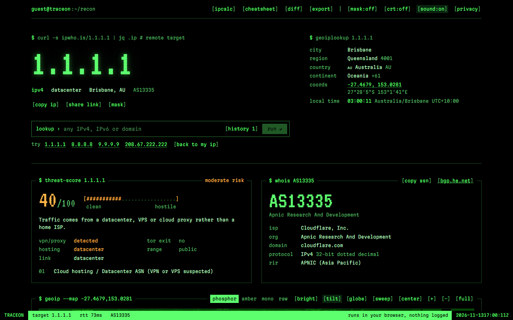
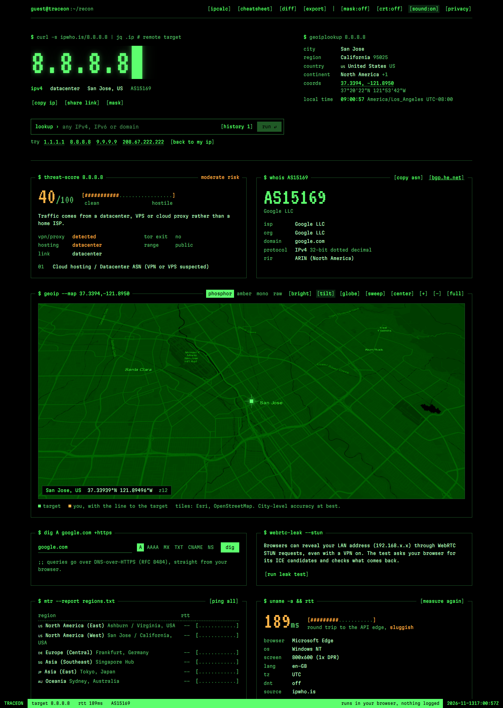

# TRACEON

See your public IP address, where it geolocates, who routes it, and whether your browser leaks it. TRACEON runs entirely in your browser: there is no backend, and nothing you look up is stored on a server.

**Live site: [traceonip.web.app](https://traceonip.web.app)**



## Features

**Your connection**
- Detects your public IPv4 or IPv6 address on load, falling back across several providers if one is down.
- Shows city, region, country, coordinates (decimal and DMS), and the live local time at that location.
- Measures round-trip latency and lists what your browser reports about itself (browser, OS, screen, language, time zone, Do Not Track).

**Look up any address**
- Enter any IPv4 address, IPv6 address, or domain name, or pick a preset (Cloudflare, Google, Quad9, OpenDNS).
- Share a lookup as a link: `?lookup=8.8.8.8`.
- Private, loopback, and reserved ranges (RFC 1918 and similar) are recognised and explained instead of returning a misleading result.
- Recent lookups are kept in your browser's local storage and can be cleared in one click.

**Network and risk**
- ASN, ISP, organisation, and the Regional Internet Registry that allocated the range, with a link to bgp.he.net.
- A 0–100 risk score with flags for VPN or proxy, Tor exit, datacenter hosting, and private range.

**Map**
- Interactive map (MapLibre GL) centred on the address, with tilt, globe projection, full screen, and several tints.
- When you look up another address, a line connects your location to the target.

**Privacy checks**
- WebRTC leak test: checks whether your browser exposes a local network address through STUN, even behind a VPN.
- DNS lookup over HTTPS (RFC 8484) for A, AAAA, MX, TXT, CNAME, and NS records.
- Latency to cloud regions in North America, Europe, Asia, Australia, and South America.

**Tools**
- IPv4 subnet calculator (network, broadcast, mask, wildcard, usable host range).
- Ready-to-copy terminal commands (`dig`, `whois`, `traceroute`, `ping`, `curl`) for the current address.
- Compare your address with a looked-up one, including the distance between them.
- Export the report as JSON or plain text.
- Mask mode hides the last part of the IP for screen sharing and streaming.



## How your data is handled

- Every lookup is made directly from your browser to the public APIs listed below. TRACEON has no server of its own that sees your requests.
- Search history and settings are stored only in your browser's `localStorage`.
- The third-party services below receive your IP address when your browser contacts them, as with any website you visit. Their own privacy policies apply.

| Purpose | Service |
| --- | --- |
| IP geolocation | [ipwho.is](https://ipwho.is), [ipapi.co](https://ipapi.co), [freeipapi.com](https://freeipapi.com) |
| DNS over HTTPS | Cloudflare (`cloudflare-dns.com`), Google (`dns.google`) |
| Map tiles | Esri, OpenStreetMap contributors |
| Fonts | Google Fonts |

Geolocation by IP is approximate. Expect city-level accuracy at best, and sometimes only the country.

## Responsible use

TRACEON is meant for learning about networking, checking your own connection, and testing your own privacy setup (for example, whether a VPN hides your address or your browser leaks over WebRTC).

- Only look up addresses you own, administer, or have permission to investigate.
- IP geolocation is not precise enough to identify or locate a person, and it must not be used to harass, track, or target anyone.
- The risk score is a heuristic based on public data. It can be wrong, and it is not grounds on its own for blocking, reporting, or accusing anyone.
- Respect the terms of service and rate limits of the APIs TRACEON relies on.
- You are responsible for complying with the laws that apply where you use this tool.

The software is provided as is, without warranty. See [LICENSE](LICENSE).

## Getting started

Requires Node.js 20 or later.

```bash
npm install
cp .env.example .env.local   # then fill in your Firebase web app values
npm run dev                  # http://localhost:5173
```

Firebase is only used for hosting. If you don't deploy to Firebase, you can leave `.env.local` empty; the app still runs and logs a warning in the console.

| Command | What it does |
| --- | --- |
| `npm run dev` | Start the development server |
| `npm run build` | Type-check and build to `dist/` |
| `npm run preview` | Serve the production build locally |
| `npm run lint` | Lint with oxlint |

## Configuration

The Firebase web config is read from environment variables so it stays out of the repository. Copy `.env.example` to `.env.local` and fill in the values from Firebase console → Project settings → Your apps.

```
VITE_FIREBASE_API_KEY=
VITE_FIREBASE_AUTH_DOMAIN=
VITE_FIREBASE_PROJECT_ID=
VITE_FIREBASE_STORAGE_BUCKET=
VITE_FIREBASE_MESSAGING_SENDER_ID=
VITE_FIREBASE_APP_ID=
```

`.env.local` is git-ignored. Note that any Firebase web config ends up in the built JavaScript that browsers download; that is expected and safe. Protect your project with security rules and by restricting the API key to your domains in Google Cloud Console.

## Deploying to Firebase Hosting

```bash
npm install -g firebase-tools
firebase login
firebase use --add          # choose your project
firebase deploy --only hosting
```

`firebase.json` builds the app before deploying, serves the `dist/` folder, rewrites every route to `index.html`, and sets security and caching headers.

## Project structure

```
├── index.html               # HTML entry point
├── firebase.json            # Hosting: dist/, SPA rewrites, headers
├── .env.example             # Firebase config template
├── public/                  # Static files copied as-is (favicon, icons)
├── docs/screenshots/        # README images
└── src/
    ├── main.tsx             # App bootstrap
    ├── firebase.ts          # Firebase initialisation from env vars
    ├── App.tsx              # Layout and app state
    ├── index.css            # Styles
    ├── types/ip.ts          # Shared types
    ├── services/
    │   ├── ipService.ts     # IP detection, lookup, latency
    │   ├── leakService.ts   # WebRTC test, DNS over HTTPS, region pings, subnet math
    │   └── soundService.ts  # Interface sounds (Web Audio API)
    └── components/          # One file per panel and dialog
```

## Built with

React 19, TypeScript, Vite, MapLibre GL, and Firebase Hosting.

## License

[MIT](LICENSE)
